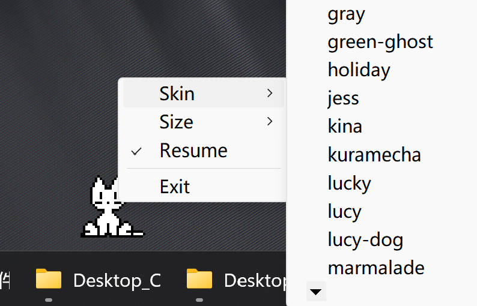
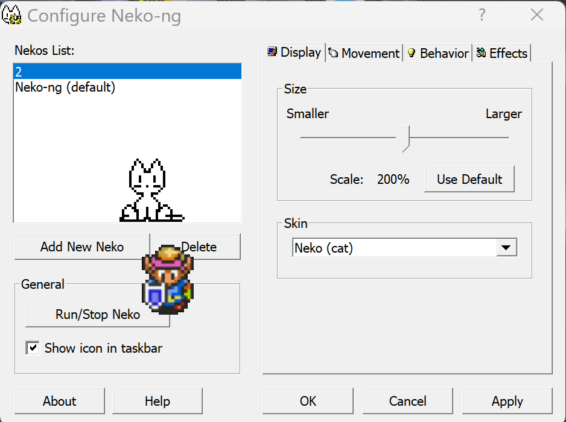

# 🐾 Desktop Critters

### Little Friends on Your Desktop

**一个轻巧、便携的 Windows 桌面宠物程序。**

**A lightweight and portable desktop pet application for Windows.**

**语言 / Language:** [简体中文](#简体中文) | [English](#english)

---

[下载最新版本 Download Latest Version](https://github.com/CSLRJ/Desktop-Critters/releases/latest)

---

### 软件截图

**右键菜单与皮肤切换**



**配置界面**



---

## 简体中文

## ✨ 项目简介

**Desktop Critters** 基于开源项目 Neko-ng 改造和扩展。

你可以在桌面上同时拥有多只宠物。它们能够追逐鼠标、自由移动、被拖动后坠落，也可以随时更换外观。每只宠物都可以独立选择自己的皮肤。

项目保留了经典桌面宠物的简单乐趣，并在皮肤数量、物理效果、兼容性和资源管理方面进行了扩展。

## 🎨 皮肤与功能

| 功能 | 说明 |
|---|---|
| 动画皮肤 | 共 76 套，每套 32 帧 |
| 多宠物 | 支持多只宠物同时活动 |
| 独立换肤 | 每只宠物可以单独切换皮肤 |
| 皮肤保存 | 每只宠物的皮肤选择独立保存 |
| 物理效果 | 拖动、重力坠落、坐定姿态和落地反弹 |
| 其他操作 | 调整大小、暂停、恢复和退出 |
| 配置管理 | 通过独立配置程序修改设置 |

所有皮肤均嵌入主程序，无需额外下载或安装素材文件。多只宠物使用相同皮肤时，可以共享缓存资源。

## 🛠️ 项目来源与制作

Desktop Critters 基于 [Alex313031/Neko-ng](https://github.com/Alex313031/neko-ng) 开发，是在经典 Neko 桌面宠物基础上进行功能扩展和优化的独立衍生项目。

项目整合了 [eliot-akira/neko](https://github.com/eliot-akira/neko) 中 `2023-icon-library` 目录提供的 74 套动画素材，并保留 Neko-ng 原有的 Neko 和 Penguin 动画，最终形成 76 套皮肤。

在原项目基础上，本项目进行了代码修改、功能扩展、资源整合和性能优化，逐步形成现在的 Desktop Critters。

**开发者：** CSLRJ

**开发辅助：** GLM-V5.3-Flash，用于辅助代码分析、修改、调试和功能扩展。

本项目并非 Neko-ng 官方版本，与原作者及素材提供者保持独立。

### 开发环境

- **构建工具：** Visual Studio 2022 MSBuild
- **编译工具集：** v141_xp
- **Windows SDK：** Windows 7.1A SDK
- **目标平台：** Win32 / x86
- **运行库：** 静态运行库 `/MT`
- **开发辅助：** GLM-V5.3-Flash

## ⚙️ 主要改进

- 保留并修复原有 Neko 和 Penguin 皮肤。
- 整合 74 套动画皮肤，最终共计 76 套。
- 新增 DPI 自动适配，支持手动缩放。
- 支持多只宠物同时活动，每只宠物可以使用不同皮肤。
- 支持每只宠物独立保存皮肤设置，并在下次启动时恢复。
- 新增拖动后的重力坠落动画，加入落地反弹效果。
- 优化皮肤按需加载和多宠物共享缓存。
- 将设置保存位置从注册表改为程序同目录下的 `config.ini` 文件。
- 修复窗口区域设置失败路径中的 GDI 资源释放问题。
- 移除旧版脚印效果及其相关配置和资源。

## 💻 兼容性与运行表现

**目标系统：**

- Windows XP SP3（32 位）
- Windows 11

程序使用 Win32 / x86 编译和静态运行库，无需额外安装 Visual C++ 运行库。

Windows XP SP3 是本项目的兼容性目标。不同系统版本上的实际运行表现可能有所差异。

### 内存表现

程序内置 76 套动画皮肤，采用按需加载和多宠物共享缓存机制。

实际内存使用会受到 Windows 版本、宠物数量、皮肤切换、资源访问和系统内存管理机制等因素影响。

需要注意，工作集（Working Set）和提交大小（Commit Size）代表不同的内存指标。工作集会随系统内存管理动态波动，提交大小则反映进程已提交的内存，并不意味着这些内存全部驻留在物理 RAM 中。

本项目主要关注资源管理和长期运行稳定性，不以某一时刻的最低内存数值作为优化目标。

### 📦 程序文件

| 文件 | 体积 | 用途 |
|---|---:|---|
| `Desktop_Critters.exe` | 约 10.84 MB | 桌面宠物主程序 |
| `Desktop_Critters_CFG.exe` | 约 0.29 MB | 配置程序 |

主程序体积较大，主要是因为内置了 76 套动画皮肤。

## 🚀 使用方法

1. 下载便携版 ZIP 压缩包并解压。
2. 将 `Desktop_Critters.exe`、`Desktop_Critters_CFG.exe` 和 `config.ini` 保持在同一目录。
3. 双击运行 `Desktop_Critters.exe`。
4. 右键点击某只宠物，可以切换该宠物的皮肤、调整大小、暂停或恢复活动，以及退出程序。
5. 运行 `Desktop_Critters_CFG.exe` 可以修改其他配置。

首次运行时，程序使用内置默认设置。配置文件会在保存设置时自动写入内容。

## 🔒 便携与隐私

- 无需安装。
- 不写入注册表。
- 程序不需要联网，不会自动启动。
- 所有设置保存在程序同目录下的 `config.ini` 文件中。
- 整个文件夹可以自由移动或复制到其他电脑使用。

## 📜 版权与许可

本项目包含基于 Neko-ng 修改的代码，以及来自其他项目的动画素材。

- **Neko-ng：** 原始代码及历史版权归各自原作者所有。保留原项目的版权声明及相关许可证文件。
- **动画素材：** 来源于 [eliot-akira/neko](https://github.com/eliot-akira/neko) 的 `2023-icon-library` 目录。素材版权及授权条件以各自原始来源为准。
- **Desktop Critters：** 本项目新增及修改的代码由 CSLRJ 开发。其许可范围不包括第三方原始代码和素材。

第三方版权声明和许可证应随源代码一并保留。

本项目免费提供，不代表其中所有第三方代码和素材均可脱离原授权条件单独使用。

## 🙏 致谢

感谢 Neko-ng 原作者 Alex313031、eliot-akira，以及相关动画和图标素材的创作者。

感谢 GLM-V5.3-Flash 在开发过程中的辅助。

---

## 📁 项目文件结构

项目源码按照实际工程结构整理，保留必要的源代码、资源文件、Visual Studio 工程文件和构建文档。

### 仓库中的实际结构

```text
Desktop-Critters/
├── .gitattributes
├── .gitignore
├── BUILDING.md
├── README.md
├── SOURCE_CODE_GUIDE.txt
├── THIRD-PARTY-NOTICES.md
├── build.ps1
├── license.txt
│
└── src/
    ├── NekoCFG/
    ├── res/
    ├── Neko98.sln
    ├── Neko98.vcxproj
    ├── Neko98.vcxproj.filters
    └── 主程序源码及其他必要工程文件
```

### 源码目录说明

- `src/`：程序源代码、Visual Studio 工程文件及资源。
- `src/NekoCFG/`：独立配置程序的源码和工程文件。
- `src/res/`：动画皮肤、图标及其他程序资源，包含 76 套皮肤，每套 32 帧。
- `BUILDING.md`：编译环境、构建方法和部署说明。
- `SOURCE_CODE_GUIDE.txt`：源码结构、主要类和关键功能的维护指南。
- `build.ps1`：自动编译及便携版部署脚本。
- `THIRD-PARTY-NOTICES.md`：第三方版权声明。
- `license.txt`：原始许可证文件。

### 编译与部署

下载完整源码后，按照 `BUILDING.md` 中的说明配置编译环境。

运行根目录中的 `build.ps1`，即可执行自动编译和便携版部署。

编译成功后，程序会部署到 `DC_portable/` 目录，其中包含：

```text
DC_portable/
├── Desktop_Critters.exe
├── Desktop_Critters_CFG.exe
└── config.ini
```

`DC_portable/` 是构建时生成的便携版目录，不属于必须提交到源码仓库的源代码文件。

---

**Created by CSLRJ**

2026年11月23日

---

## English

## ✨ About

**Desktop Critters** is an enhanced and extended version based on the open-source project Neko-ng.

You can have multiple little pets living on your desktop at the same time. They can chase your mouse cursor, move around freely, be dragged and dropped, and fall under gravity. Each pet can independently select its own skin.

The project preserves the simple charm of classic desktop pets while extending its skin collection, physical interactions, compatibility, and resource management.

## 🎨 Skins & Features

| Feature | Description |
|---|---|
| Animated skins | 76 skins, with 32 frames per skin |
| Multiple pets | Multiple pets can be active simultaneously |
| Independent skins | Each pet can select its own skin |
| Persistent settings | Each pet's skin selection is saved independently |
| Physics effects | Dragging, gravity-based falling, sitting animations, and landing bounce |
| Other controls | Resize, pause, resume, and exit |
| Configuration | Modify settings through a separate configuration utility |

All skins are embedded in the main executable. No additional skin files or downloads are required. Pets using the same skin can share cached resources.

## 🛠️ Project Origins & Development

Desktop Critters is based on [Alex313031/Neko-ng](https://github.com/Alex313031/neko-ng) and is an independent derivative project that extends and improves upon the classic Neko desktop pet.

The project incorporates 74 sets of animated assets from the `2023-icon-library` directory in [eliot-akira/neko](https://github.com/eliot-akira/neko), while retaining the original Neko and Penguin animations from Neko-ng. This brings the total collection to 76 skins.

Building upon the original project, I modified the source code, expanded its functionality, integrated additional resources, and optimized its performance to create Desktop Critters.

**Developer:** CSLRJ

**AI-assisted development:** GLM-V5.3-Flash, used to assist with code analysis, modifications, debugging, and feature development.

This project is not an official release of Neko-ng and is independently maintained.

### Development Environment

- **Build system:** Visual Studio 2022 MSBuild
- **Compiler toolset:** v141_xp
- **Windows SDK:** Windows 7.1A SDK
- **Target platform:** Win32 / x86
- **Runtime library:** Static runtime (`/MT`)
- **Development assistance:** GLM-V5.3-Flash

## ⚙️ Key Improvements

- Preserved and repaired the original Neko and Penguin skins.
- Integrated 74 additional animated skins, bringing the total to 76.
- Added automatic DPI scaling and manual size adjustment.
- Added support for multiple pets, each with its own skin.
- Added independent skin settings for each pet, restored on the next launch.
- Added gravity-based falling animations after dragging, including a landing bounce effect.
- Optimized on-demand skin loading and shared caching between pets.
- Replaced registry-based settings storage with a `config.ini` file in the application directory.
- Fixed a GDI resource handling issue in the window-region update failure path.
- Removed the legacy footprint effect and its related configuration and resources.

## 💻 Compatibility & Performance

**Target operating systems:**

- Windows XP SP3 (32-bit)
- Windows 11

The application is built for Win32 / x86 and uses the static runtime library, so no additional Visual C++ runtime installation is required.

Windows XP SP3 is a compatibility target. Actual runtime behavior may vary across operating system versions.

### Memory Usage

The application embeds all 76 animated skins and uses on-demand loading and shared caching between pets.

Actual memory usage depends on factors such as the Windows version, number of pets, skin switching, resource access, and system memory management.

Working Set and Commit Size represent different memory metrics. Working Set fluctuates dynamically with system memory management, while Commit Size represents memory committed by the process and does not mean that all of it is currently resident in physical RAM.

The project focuses on resource management and long-term stability rather than minimizing memory figures at a particular moment.

### 📦 Included Applications

| File | Approx. Size | Description |
|---|---:|---|
| `Desktop_Critters.exe` | 10.84 MB | Main desktop pet application |
| `Desktop_Critters_CFG.exe` | 0.29 MB | Configuration utility |

The main executable is relatively large because it contains all 76 animated skins.

## 🚀 How to Use

1. Download and extract the portable ZIP archive.
2. Keep `Desktop_Critters.exe`, `Desktop_Critters_CFG.exe`, and `config.ini` in the same directory.
3. Double-click `Desktop_Critters.exe` to launch the desktop pets.
4. Right-click a pet to switch its skin, adjust its size, pause or resume its activity, or exit the application.
5. Run `Desktop_Critters_CFG.exe` to modify additional settings.

On first launch, the application uses built-in defaults. The configuration file is automatically populated when settings are saved.

## 🔒 Portability & Privacy

- No installation required.
- Does not write to the Windows registry.
- No network connection required.
- Does not automatically launch at Windows startup.
- All settings are stored in a `config.ini` file in the application directory.
- The entire application folder can be moved or copied to another computer.

## 📜 Copyright & Licensing

This project contains modified code derived from Neko-ng, as well as animated assets originating from another project.

- **Neko-ng:** Original source code and historical copyrights belong to their respective authors. The original copyright notices and applicable license files are retained.
- **Animated assets:** The incorporated assets originate from the `2023-icon-library` directory in [eliot-akira/neko](https://github.com/eliot-akira/neko). Copyright and licensing conditions remain subject to their respective original sources.
- **Desktop Critters:** New and modified code contributed to this project was developed by CSLRJ. This does not grant rights to third-party source code or assets.

Third-party copyright notices and license files must be retained and respected when using or redistributing the project.

The project is provided free of charge. This does not mean that all third-party code or assets may be used independently of their original licensing conditions.

## 🙏 Acknowledgements

Special thanks to Alex313031, the original developer of Neko-ng, and eliot-akira, along with the creators of the animated and icon assets used in this project.

Thanks also to GLM-V5.3-Flash for its assistance throughout the development process.

---

## 📁 Project Structure

The source code is organized using the actual project structure, retaining the necessary source files, resources, Visual Studio project files, and build documentation.

### Repository Layout

```text
Desktop-Critters/
├── .gitattributes
├── .gitignore
├── BUILDING.md
├── README.md
├── SOURCE_CODE_GUIDE.txt
├── THIRD-PARTY-NOTICES.md
├── build.ps1
├── license.txt
│
└── src/
    ├── NekoCFG/
    ├── res/
    ├── Neko98.sln
    ├── Neko98.vcxproj
    ├── Neko98.vcxproj.filters
    └── Main source files and other required project files
```

### Source Directory Overview

- `src/`: Application source code, Visual Studio project files, and resources.
- `src/NekoCFG/`: Source code and project files for the configuration utility.
- `src/res/`: Animated skins, icons, and other application resources. Contains 76 skins, with 32 frames per skin.
- `BUILDING.md`: Build environment, compilation, and deployment instructions.
- `SOURCE_CODE_GUIDE.txt`: Source structure, major classes, and maintenance guidance.
- `build.ps1`: Automated build and portable deployment script.
- `THIRD-PARTY-NOTICES.md`: Third-party copyright notices.
- `license.txt`: Original license file.

### Building & Deployment

After downloading the complete source code, follow the instructions in `BUILDING.md` to configure the build environment.

Run `build.ps1` from the project root directory to compile and deploy the portable application.

After a successful build, the application will be deployed to `DC_portable/`, containing:

```text
DC_portable/
├── Desktop_Critters.exe
├── Desktop_Critters_CFG.exe
└── config.ini
```

`DC_portable/` is generated during the build process and does not need to be included in the source code repository.

---

**Created by CSLRJ**

November 23, 2026
